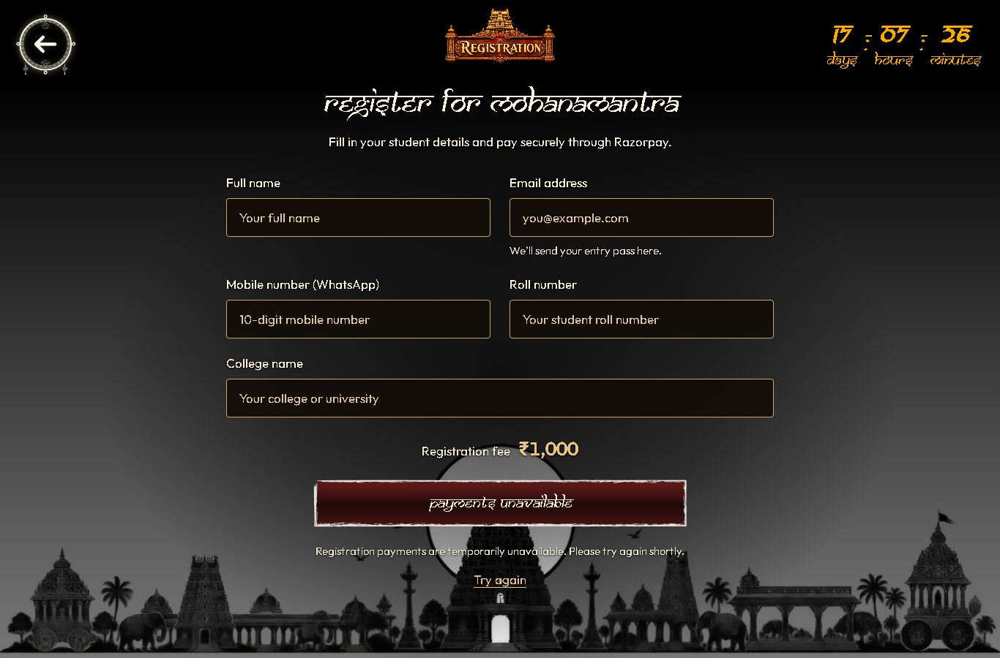
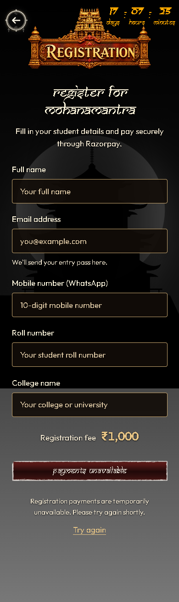
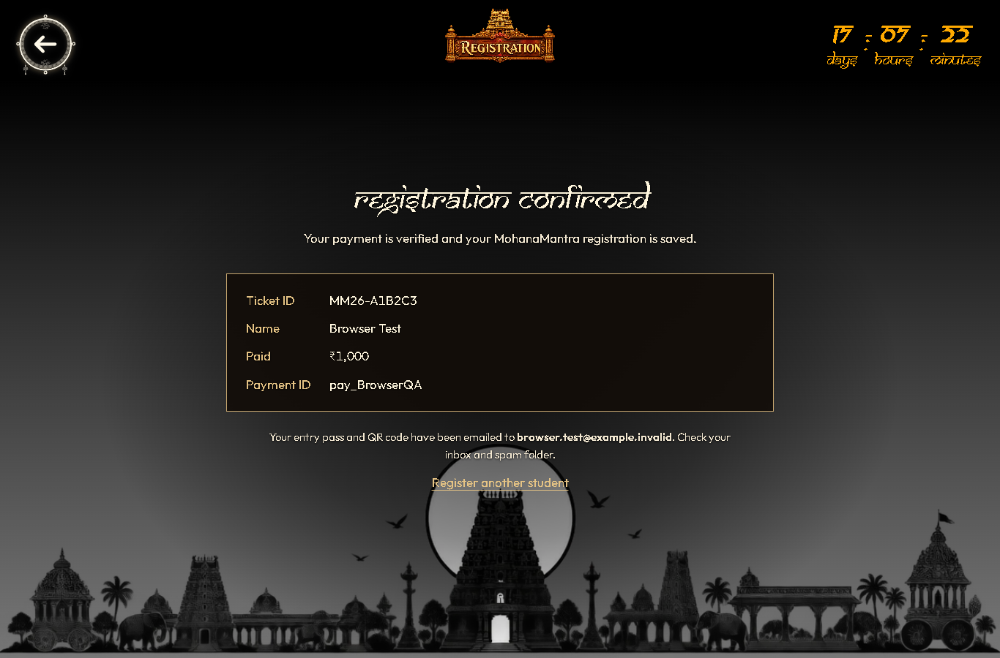

# Local registration verification — 12 October 2026

The five-field website form, server-created Razorpay orders, captured-payment verification, Firestore tickets, and Google email queue were verified locally. Razorpay and email delivery were substituted; no real payment, production database write, or confirmation email was performed.

## Results

| Check | Result |
| --- | --- |
| Production TypeScript/Vite build | Passed; Vite reports the existing large-bundle warning |
| ESLint for changed TypeScript/TSX and Vite config | Passed |
| Backend/queue sender syntax checks | Passed |
| Actual Express payment routes with isolated providers | **21 passed, 0 failed** |
| Real Firestore emulator transactions and rules | **7 passed** |
| Desktop form at 1366 × 900 | Five readable fields; no horizontal overflow |
| Mobile form at 390 × 844 | One-column form, 17px input text, document scroll, no horizontal overflow |
| UI detector | No findings |
| Diff whitespace check | Passed |

## Browser behavior

An isolated browser injected `browser-fixture.js`; the user's local preview used the actual backend and remained unmocked.

- Required fields prevented order creation.
- A successful simulated checkout used the order ID returned by the server and displayed the verified ticket.
- A failed pending-order write did not open checkout or display a paid registration.
- An incomplete checkout confirmation disabled another payment and provided the registration-team recovery path.
- A verification outage kept the payment pending and blocked another checkout.
- A cancelled checkout reused the same order when the details were unchanged.
- A paid registration with a failed/pending email did not claim the pass had been emailed.
- A pending payment remained unconfirmed through all six polls and kept the pay action unavailable.
- Refresh preserved valid proof; confirmation after refresh created zero new orders and opened zero new checkouts.
- Refresh with incomplete proof kept another payment blocked.

## Firestore behavior

The CLI used demo project `demo-mohana-mantra` with the emulator on loopback port 8181. The test refuses any non-loopback emulator address. The seven checks covered pending student records and timestamps, browser read/write denial, captured-payment ticket creation, concurrent callback/webhook processing, retry after failed email, underpayment rejection, and the local email sender consuming the queue while skipping unpaid records.

The emulator shut down after the checks. `firestore.rules` is prepared in the repository and has not been deployed to the cloud project.

## Current real configuration

The local API returns `ready: false`. A live-mode Razorpay key ID is present, while the Razorpay key secret, webhook signing secret, and ticket-signing secret remain placeholders. Gmail settings and the Firebase service-account file are present; their real SMTP delivery and production Firestore access were not exercised by these checks. Actual private environment files were preserved.

A matching test-mode Razorpay key pair is needed for an actual sandbox payment. Production registration also requires valid webhook/QR secrets, protected cloud Firestore rules, and a functioning email sender.

The automatic email implementation is JavaScript (`server/services/email.js`), called from the payment server. The Python files in the project process images. Render Free blocks Gmail SMTP ports; the added local queue sender can retain the official Google mailbox when the backend uses `TICKET_EMAIL_MODE=external`. That sender must stay running on a trusted machine that permits Gmail connections. Only its help output and isolated queue behavior were tested; it was not started with real credentials.

## Evidence

Actual local form, payments unavailable:

Simulated successful checkout and confirmed ticket:

For setup commands, webhook settings, and the local Google sender, see [registration setup](../../docs/registration-setup.md). Earlier reports and screenshots in this directory describe previous checks and are historical.
